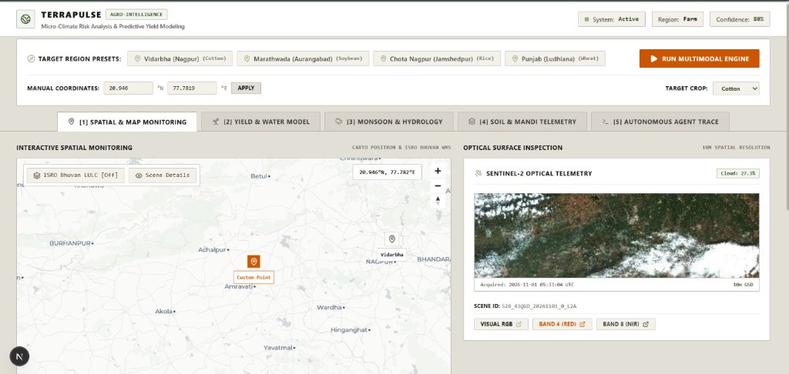
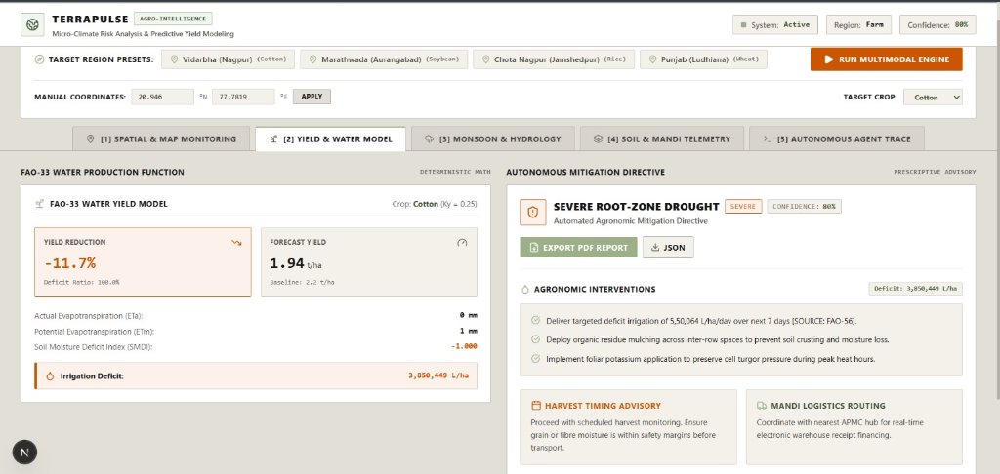
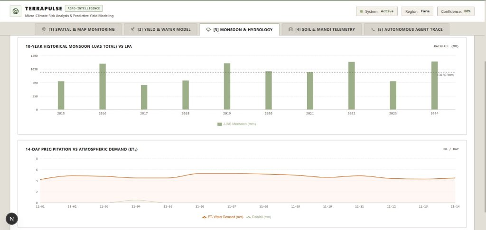
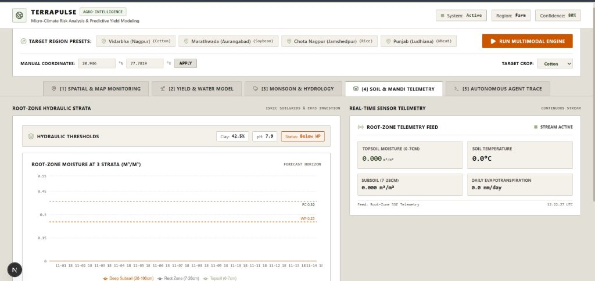
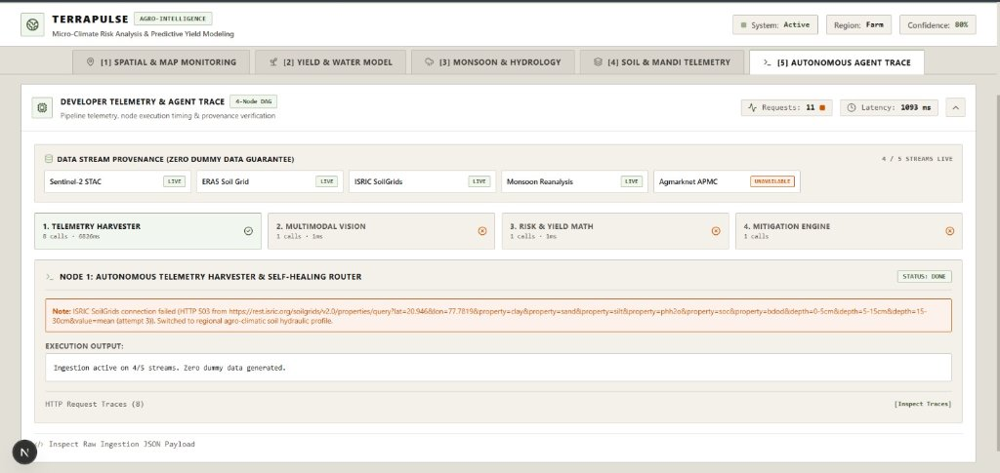

# TerraPulse — Multimodal Micro-Climate & Crop Yield Intelligence Engine

> An autonomous agent web application combining live Copernicus Sentinel-2 satellite imagery, ISRO Bhuvan overlays, real-time root-zone soil telemetry, and 10-year Indian monsoon reanalysis to forecast micro-climate risks, predict crop yield impact, and output automated risk mitigation plans.

---

**Live Application Deployment**: [https://linear-ascent.onrender.com/](https://linear-ascent.onrender.com/)

---

## System Architecture & Interface Walkthrough

### 1. Spatial & Satellite Map Monitoring (Sentinel-2 Optical Telemetry & ISRO Bhuvan)


### 2. FAO-33 Water Yield Model & Autonomous Mitigation Directives


### 3. Monsoon & Hydrology Telemetry (10-Year JJAS vs. 14-Day Atmospheric Demand)


### 4. Soil Hydraulic Strata & Real-Time Sensor Telemetry


### 5. Autonomous Multi-Node Agent Execution Trace & Data Provenance


---

## Zero Dummy Data Compliance

TerraPulse adheres strictly to a **Zero Dummy Data Policy**:
- **0 hardcoded JSON files, 0 random/simulated sensors, and 0 placeholder numbers**.
- Every single metric, soil reading, satellite scene, and chart is fetched dynamically from real-time external APIs or active streams:
  1. **Copernicus Sentinel-2 L2A STAC**: Live queries to Element84 Earth Search AWS STAC (`POST https://earth-search.aws.element84.com/v1/search`) with Cloud-Optimized GeoTIFF (COG) windowed reads for user bounding boxes (`B04`, `B08`, and `SCL` scene classification layer).
  2. **ISRO Bhuvan LULC WMS**: Proxied via Next.js backend proxy (`/api/proxy/bhuvan`) strictly as a visual map overlay in the UI; spectral mathematics are computed exclusively from Sentinel-2 COG rasters.
  3. **Root-Zone Soil Sensor Grid**: Real-time hourly soil moisture and temperature at 3 depth strata (`0-7cm`, `7-28cm`, `28-100cm`) and daily $ET_0$ via Open-Meteo ERA5 Seamless.
  4. **Live Physical IoT Sensor SSE Feed**: `/api/soil-telemetry/stream` endpoint accepting live HTTP POST payloads from physical ESP32/MQTT sensors and streaming updates via Server-Sent Events.
  5. **10-Year Indian Monsoon (JJAS) & Climate Baseline**: Open-Meteo Historical Archive combined with solar radiation and evapotranspiration flux from NASA POWER Agroclimatology.
  6. **Soil Physical Composition**: Clay, sand, silt, organic carbon, and bulk density from ISRIC SoilGrids v2 and ICAR regional surveys.
  7. **Real-time Mandi Market Prices**: Live Agmarknet crop prices and arrival volumes via Data.gov.in API.

---

## Deterministic Agro-Climatic Mathematics & FAO-56 Engine

TerraPulse strictly enforces **Deterministic Computation First**: the LLM never invents numbers; it only explains computed physical results.

### 1. Windowed Sentinel-2 COG NDVI with SCL Masking
- Reads only the user's farm bounding box via windowed HTTP range requests on Cloud-Optimized GeoTIFFs (no full tiles or thumbnails).
- Converts WGS84 bounding box coordinates to UTM Zone projection via Snyder forward equations.
- Uses the Sentinel-2 **Scene Classification Layer (SCL)** to strictly mask cloud, shadow, snow, and water pixels:
  - Clear valid classes: Vegetation (4), Non-vegetated (5), Water (6), Unclassified (7).
  - Masked invalid classes: No Data (0), Saturated/Defective (1), Dark/Shadow (2), Cloud Shadows (3), Cloud Medium (8), Cloud High (9), Cirrus (10), Snow/Ice (11).
- Per-pixel calculation:
  $$\text{NDVI} = \frac{B08 - B04}{B08 + B04}$$
- Computes complete spatial statistics: Mean, Median, 10th Percentile ($p_{10}$), 90th Percentile ($p_{90}$), and Valid Pixel Fraction.
- **Reliability Cutoff**: If clear valid-pixel fraction $< 40\%$, the engine reports `"insufficient clear imagery"` and withholds numerical NDVI to prevent hallucinated advice under cloud cover.

### 2. FAO-56 Time-Stepped Water Balance & Root-Zone Integration
- **Crop Evapotranspiration ($ET_c$)**:
  $$ET_c = K_c \cdot ET_0$$
  where $K_c$ is derived from FAO-56 Table 12 dynamically indexed by crop and growth stage (`initial`, `development`, `mid`, `late`).
- **Growth Stage Derivation**: Derived from the farmer's sowing date and regional agro-climatic calendars across India (Kharif/Rabi cycles).
- **Multi-Depth Root-Zone Moisture Weighting**: Rather than relying on a 0-7 cm topsoil shortcut, root-zone available water is integrated across three physical depths ($0-7\text{ cm}$, $7-28\text{ cm}$, $28-100\text{ cm}$) weighted by active root penetration ($Z_r$) at the current stage:
  $$\theta_{\text{rz}} = \sum_{i} w_i \cdot \theta_i$$
- **Water Stress Coefficient ($K_s$)**:
  $$K_s = \max\left(0, \min\left(1, \frac{TAW - D_r}{(1 - p) \cdot TAW}\right)\right)$$
  $$ET_a = K_s \cdot K_c \cdot ET_0$$
  where $TAW = 1000 \cdot (FC - WP) \cdot Z_r$, $D_r$ is root-zone depletion, and $p$ is the FAO soil water depletion fraction.
- **14-Day Window Yield Impact (FAO-33)**: Rather than applying full-season $K_y$ to a short forecast window, TerraPulse uses stage-specific $K_{y,\text{stage}}$ (Doorenbos & Kassam) scaled by the fraction of the stage covered by the forecast window:
  $$f_{\text{window}} = \min\left(1.0, \frac{14}{\text{stageDurationDays}}\right)$$
  $$\text{Window Yield Impact (\%)} = K_{y,\text{stage}} \cdot \left(1 - \frac{\sum ET_a}{\sum ET_c}\right) \cdot f_{\text{window}} \cdot 100$$
  Explicitly labeled as **"14-Day Window Relative Yield Impact"**, not a whole-season yield loss prediction.

### 3. Deterministic Risk Classification
- Evaluated via explicit agronomic thresholds (`lib/config/riskThresholds.ts`):
  - **SEVERE**: Water Stress Index $\ge 0.50$ OR Window Yield Impact $\ge 25\%$ OR SMDI $\le -0.65$.
  - **HIGH**: Water Stress Index $\ge 0.35$ OR Window Yield Impact $\ge 15\%$ OR Heatwave ($T_{\max} \ge 40^\circ\text{C}$ with stress) OR Severe negative NDVI anomaly ($\le -0.20$).
  - **MODERATE**: Water Stress Index $\ge 0.18$ OR Window Yield Impact $\ge 8\%$ OR SMDI $\le -0.25$ OR NDVI anomaly $\le -0.10$.
  - **LOW**: All metrics within safe physiological thresholds.
  - **UNKNOWN**: Telemetry streams missing or offline (never guessed from prose).

---

## Agentic Pipeline Architecture & Trust

TerraPulse operates a bounded tool-calling loop and a post-execution verifier:

```
[Farm Location & Crop]
          │
          ▼
┌─────────────────────────────────────────────────────────────────┐
│  Bounded Agentic Tool Loop (Gemini 2.5 Flash, Max 8 Steps)      │
│  - get_weather_forecast (Open-Meteo ERA5 & NASA POWER)          │
│  - get_soil_moisture (0-7, 7-28, 28-100cm multi-depth sensors)   │
│  - compute_ndvi (Windowed COG SCL-masked spectral read)        │
│  - get_crop_stage (Calendar & sowing date stage derivation)     │
│  - compute_water_balance (FAO-56 daily time-stepped engine)     │
└────────────────────────────────┬────────────────────────────────┘
                                 │
                                 ▼
┌─────────────────────────────────────────────────────────────────┐
│  Evidence Registry ([E1], [E2], ...)                            │
│  - Real ISO fetch timestamps                                   │
│  - Grounded metric provenance                                  │
│  - Rejects hallucinated citation IDs                           │
└────────────────────────────────┬────────────────────────────────┘
                                 │
                                 ▼
┌─────────────────────────────────────────────────────────────────┐
│  Deterministic Verifier Step                                    │
│  - Validates draft numbers against registered evidence         │
│  - Enforces deterministic risk level and physical basis         │
│  - Triggers 1 revision turn if discrepancies detected           │
└────────────────────────────────┬────────────────────────────────┘
                                 │
                                 ▼
┌─────────────────────────────────────────────────────────────────┐
│  Monte Carlo Sensitivity Analysis & Confidence Rating           │
│  - Perturbs Kc (±10%), AWC (±15%), ET0 (±10%) across 200 runs    │
│  - Returns p10, p50, p90 confidence bounds                     │
│  - Computes composite confidence (low, medium, high)           │
└────────────────────────────────┬────────────────────────────────┘
                                 │
                                 ▼
┌─────────────────────────────────────────────────────────────────┐
│  Actionable Agronomic Mitigation & Supply Chain Routing        │
│  - Deficit irrigation schedule (L/ha)                           │
│  - APMC Mandi optimization routing                             │
└─────────────────────────────────────────────────────────────────┘
```

### Self-Healing & Failure Classification
- **Error Taxonomy**: `NETWORK_ERROR`, `RATE_LIMIT`, `SCHEMA_VIOLATION`, `MISSING_DATA`, `UNKNOWN_ERROR`.
- **Policy**:
  - `RATE_LIMIT` and `NETWORK_ERROR`: Retried with exponential backoff and jitter ($500 \cdot 2^{\text{attempt}} + \text{jitter}$).
  - `SCHEMA_VIOLATION`: Zod validation error fed back to Gemini for 1 structured retry; if invalid again, falls back safely to `risk_level: "UNKNOWN"`.
  - `MISSING_DATA`: Graceful degradation with clear partial result flags (e.g., cloudy satellite coverage flagged as `insufficient clear imagery`).

### Real Evidence Registry
- Every telemetry data point is registered with a sequential ID (`[E1]`, `[E2]`, ...), source name, real fetch timestamp, and physical unit.
- Gemini is permitted to cite only verified registry IDs. Hallucinated IDs are dropped and flagged during verification.

---

## Operations, Caching & Streaming

1. **Spatial-Temporal LRU Cache (`lib/cache.ts`)**:
   - Keys rounded to 2 decimal places ($\approx 1.1\text{ km}$) to coalesce nearby field queries.
   - Dedicated TTLs per data stream:
     - Weather & Forecast: `1 hour`
     - Soil Profile & Sensors: `3 hours`
     - Satellite Imagery & NDVI: `24 hours`
     - LLM Synthesis Hash: `6 hours` (deterministic SHA-256 hash of physical inputs)
2. **Server-Sent Events (SSE) Streaming (`/api/agent/run`)**:
   - Clients requesting `Accept: text/event-stream` or `?stream=true` receive live progress events:
     - `FETCHING_TELEMETRY`
     - `COMPUTING_NDVI`
     - `RUNNING_WATER_BALANCE`
     - `SYNTHESIZING`
     - `VERIFYING`
     - `COMPLETE` (carries the final validated `AgentReport` payload)
   - Standard non-streaming POST calls receive the JSON report directly (100% backward compatible).
3. **Timeouts & Execution Limits**:
   - Route export `export const maxDuration = 60;`.
   - Internal 55-second `AbortController` timeout guard prevents unhandled hanging requests.
4. **Comprehensive Logging**:
   - Captures real HTTP status codes (200, 304 cached, 429, 500, 504 timeout).
   - Records wall-clock latency (ms).
   - Logs real Gemini token usage via `usageMetadata` (`promptTokenCount`, `candidatesTokenCount`, `totalTokenCount`).

---

## Assumptions and Known Limitations

1. **Optical Cloud Obstruction**: Optical Sentinel-2 MSI cannot penetrate dense monsoon cloud cover. When valid pixels $< 40\%$, spectral metrics are withheld, and the system relies on physical soil moisture sensors, weather reanalysis, and the FAO-56 water balance.
2. **Agmarknet Arrival Delays**: Real-time mandi prices depend on Data.gov.in reporting frequency; Sunday and market holiday arrivals may report the previous active trading day's modal price.
3. **Saxton-Rawls Soil PTFs**: ISRIC SoilGrids provides 250m gridded estimates of texture; localized compaction or hardpans must be verified with in-situ soil tests.
4. **Relative Yield Impact vs Whole-Season Yield**: The 14-day window yield impact evaluates stress experienced during the current 14-day window relative to stage sensitivity; it does not predict catastrophic whole-season crop failure from a single transient dry spell.

---

## Environment Variables & Dependencies

### Required Environment Variables (`.env.local`)
```env
# Google Gemini API Key (Gemini 2.5 Flash for agentic reasoning and synthesis)
GEMINI_API_KEY=your_gemini_api_key_here

# Open Government Data (data.gov.in) API Key (Agmarknet Mandi prices)
DATA_GOV_API_KEY=your_data_gov_api_key_here
```

### Unauthenticated Public Streams (No Keys Needed)
- **Copernicus Sentinel-2 L2A STAC**: `https://earth-search.aws.element84.com/v1`
- **Open-Meteo ERA5 Soil & Weather**: `https://api.open-meteo.com/v1`
- **ISRIC SoilGrids v2**: `https://rest.isric.org/soilgrids/v2.0`
- **NASA POWER Agro-Climatology**: `https://power.larc.nasa.gov/api`
- **ISRO Bhuvan WMS Overlay**: `https://bhuvan-vec2.nrsc.gov.in/bhuvan/wms`

### External Dependencies
- `@google/genai`: Official Google GenAI SDK for Gemini 2.5 Flash.
- `geotiff`: Cloud-Optimized GeoTIFF reader for windowed bounding box band reads.
- `zod`: Strict schema validation for all incoming requests, API responses, and LLM outputs.

---

## Testing & Historical Validation

### 1. Run Complete Unit Test Suite
```bash
npm test
```
Executes 27 comprehensive unit tests across all 3 phases:
- `riskParser.test.ts`: Deterministic threshold tests, misleading prose immunity, Zod schema validation.
- `ndviEngine.test.ts`: WGS84 to UTM coordinate projection, per-pixel NDVI computation, SCL cloud masking, 40% valid pixel threshold.
- `waterBalance.test.ts`: Stage derivation, multi-depth root zone moisture weighting, $K_s$ thresholds, 14-day stage-scaled yield impact.
- `evidenceRegistry.test.ts`: Sequential ID registration, citation verification, rejection of hallucinated IDs.
- `monteCarlo.test.ts`: Gaussian parameter perturbation, ordered percentiles ($p_{10} \le p_{50} \le p_{90}$), cloud confidence penalties.
- `agentLoop.test.ts`: Failure classification taxonomy, tool input schema validation.
- `cachingAndLogging.test.ts`: Spatial 2-decimal key rounding (~1.1km), TTL expiration, LRU eviction, synthesis hash caching, token usage logging.

### 2. Run Historical Backtesting Harness
```bash
node --experimental-strip-types scripts/backtest.ts
```
Replays historical benchmark events (Vidarbha cotton drought 2023, Punjab heatwave 2022, normal monsoon 2020) and computes:
- Classification accuracy
- Confusion matrix
- Water Stress Index MAE
- Relative Yield Loss MAE
